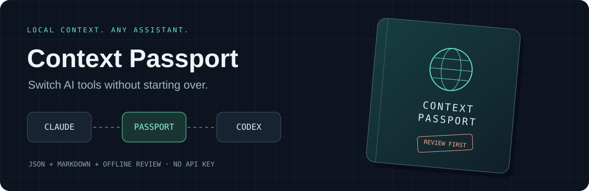

# Context Passport

**Switch AI tools without starting over.**

Turn an explicitly selected Claude or Codex transcript into a small, reviewable handoff: the goal, decisions, claimed progress, open blockers, next steps, recorded test commands, and optional Git changes — all with source references.

[](https://github.com/PedramNoSkill/context-passport/actions/workflows/ci.yml)
[](https://www.python.org/downloads/)
[](LICENSE)

[English](README.md) · [简体中文](README.zh-CN.md) · [Русский](README.ru.md) · [Privacy](docs/PRIVACY.md) · [Formats](docs/FORMATS.md)



## Your context travels. Your data stays local.

You spend an hour debugging in Claude. Then you move to Codex and spend the next twenty minutes explaining everything again.

Context Passport turns that handoff into files you can inspect, edit through explicit notes, and carry yourself. No model subscription, embedding service, database, or account is required. The runtime uses only the Python standard library.

```text
Claude / Codex / chat export       Git worktree (optional)
                \                   /
                 parse → extract → redact
                           |
           passport.json · HANDOFF.md · review.html
                           |
             review, then share with your next assistant
```

## Try it

Python 3.10 or newer is required. Git is needed only when you request `--repo`.

```bash
pip install "git+https://github.com/PedramNoSkill/context-passport.git"
context-passport demo --out ./passport-demo
```

Or run directly from a checkout:

```bash
git clone https://github.com/PedramNoSkill/context-passport.git
cd context-passport
python -m venv .venv
# macOS / Linux
. .venv/bin/activate
# Windows PowerShell: .venv\Scripts\Activate.ps1
python -m pip install -e .
passport demo --out ./passport-demo
```

Open `passport-demo/review.html` in your browser. It works offline. The bundled conversation and historical test output are **explicitly synthetic examples**; the exported files are generated by the real CLI.

The GitHub repository is the installation source for this release. **No PyPI publication is claimed.**

## Make a real handoff

```bash
context-passport create \
  --from ./claude-session.jsonl \
  --repo ./my-project \
  --target codex \
  --title "Notes app: finish search" \
  --next "Fix the empty-result label, then rerun the suite." \
  --out ./search-passport
```

The transcript must be a local file you choose. Git capture is **off unless you pass `--repo`**. Omitting `--repo` is useful when sharing a conversation without source code.

Three outputs:

- **`HANDOFF.md`** — a source-backed briefing you can give to your next assistant.
- **`passport.json`** — versioned structured data for integrations.
- **`review.html`** — an offline review page with linked source evidence and Git changes.

To continue in another tool, attach `HANDOFF.md`, or print a target-specific briefing:

```bash
passport inspect ./search-passport
passport prompt ./search-passport --target claude
```

The tool does not secretly inject context into Claude/Codex or call their APIs. You choose what to share.

## Imports

| Input | Selection |
| --- | --- |
| Claude web exported conversation JSON | `--format claude` or auto |
| Claude Code session JSONL | `--format claude-code` or auto |
| Codex rollout JSONL | `--format codex` or auto |
| ChatGPT conversation export JSON | `--format chatgpt` or auto |
| Role-labelled text / Markdown | `--format text` or auto |

Export formats evolve. See [format examples and limits](docs/FORMATS.md) for supported records and omissions. Private reasoning, system instructions, image/base64 data, and attachments are not carried over.

A multi-conversation export requires an explicit selection:

```bash
passport conversations ./conversations.json
passport create --from ./conversations.json --conversation "conversation-id" --out ./handoff
```

There is no scanning of `~/.claude`, `~/.codex`, browser profiles, or every conversation in an account.

## Evidence before confidence

Extraction is deterministic and literal, **not an AI-generated summary**. Explicit `Goal:`, `Decision:`, `Done:`, `Next:` and `Blocked:` statements populate the briefing. Unrecognized prose stays in the evidence transcript. Your first user request becomes a fallback goal; use `--goal` to override it.

```bash
passport create --from ./session.md --out ./handoff \
  --goal "Finish accessible local search" \
  --decision "Keep storage local" \
  --done "Added an index" \
  --next "Verify focus order" \
  --blocker "Missing multilingual fixture"
```

Every item links to a transcript message or an explicit user note. Assistant statements are marked as **unverified claims**. A recorded test run requires a matching tool call and a tool result with an exit code; "all tests passed" in chat is not promoted to execution evidence. A zero exit code records the runner's outcome, not an independent audit or proof that tests are meaningful.

Git capture is read-only. It records branch, HEAD, staged/unstaged/untracked paths and an optional bounded text diff. It does not execute repository code, read untracked file contents, fetch, commit or push. Recognized secret files and symlink content are excluded from diffs. Use `--no-diff` for paths only.

## Review before sharing

Common credentials are scrubbed before any export is written: private keys, familiar API-token formats, authorization headers, URL credentials and secret assignments. Redaction counts are recorded; the original secret is not copied into those counts.

**Detection is best-effort.** It cannot identify every secret or decide which business/private information you should share. Filenames, code and conversation excerpts can still be sensitive. Review all three outputs. See [the full privacy model](docs/PRIVACY.md).

A new output directory uses private permissions where supported. Existing output files are not overwritten unless you pass `--force`, which replaces only the three managed files. Input/output collisions and output symlinks are rejected.

## Scope of v0.1

This release is a file-based handoff tool. It does not provide automatic cross-app session syncing, a global memory daemon, an MCP server, or an LLM summarizer. The intended first workflow is simple: **select → create → review → continue**.

## Development

```bash
python -m pip install -e .
python -m unittest discover -s tests -v
python -m pip install ruff build
ruff check src tests
python -m build
```

See [CONTRIBUTING.md](CONTRIBUTING.md) and the [release verification report](docs/REVIEW.md). Security reports: [SECURITY.md](SECURITY.md).

Built by [PedramNoSkill](https://github.com/PedramNoSkill). MIT licensed.
