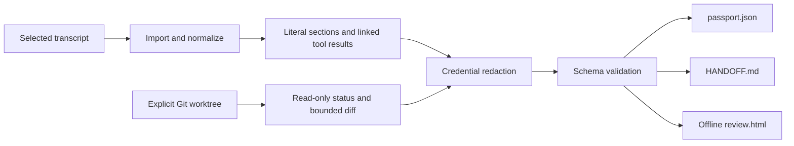

# Architecture

Context Passport is a file transformation tool with no runtime network client.

- `transcripts.py`: supported file adapters, visible-message filtering and source locators.
- `core.py`: literal section extraction, matched test-run records and schema validation.
- `redact.py`: credential-span detection and recursive JSON sanitization.
- `git_capture.py`: bounded, read-only Git capture; no project commands or remote transports.
- `render.py`: escaped Markdown and HTML; the viewer requires no server or external assets.
- `storage.py`: bounded JSON reads, protected output paths and staged file writes.
- `cli.py`: explicit user inputs, sanitized outputs and actionable errors.

## Trust boundaries

A source reference shows where a claim was recorded. It does not prove the claim is true. Tool records can also be fabricated in a user-provided transcript. No transcript command is executed; no recorded test is rerun.

The CLI validates a bundle before `inspect` or `prompt`, sanitizes displayed content again, and preserves validated redaction counts as numeric metadata. The HTML content is escaped, and inline JavaScript only filters evidence cards and follows local anchors.

Files are a portable interface rather than a shared memory database. Another assistant receives `HANDOFF.md` through the user's existing attachment/paste workflow.
